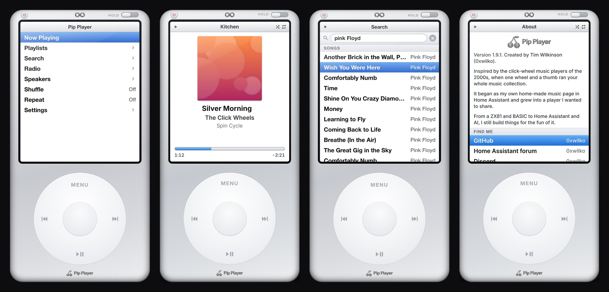
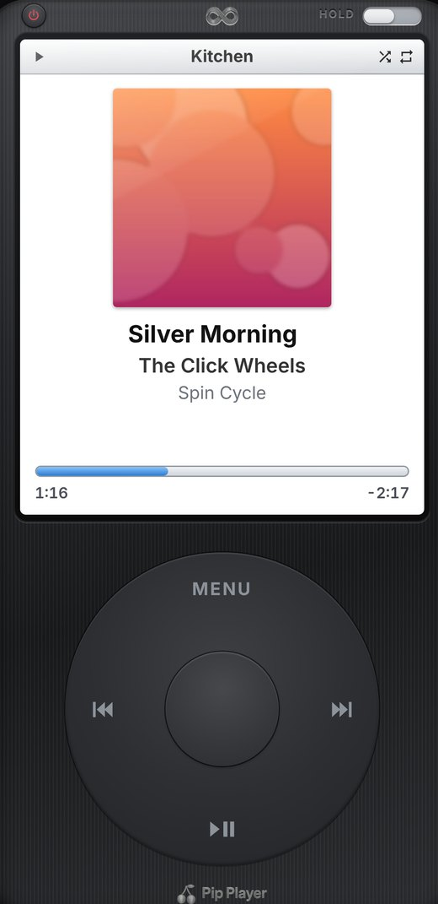
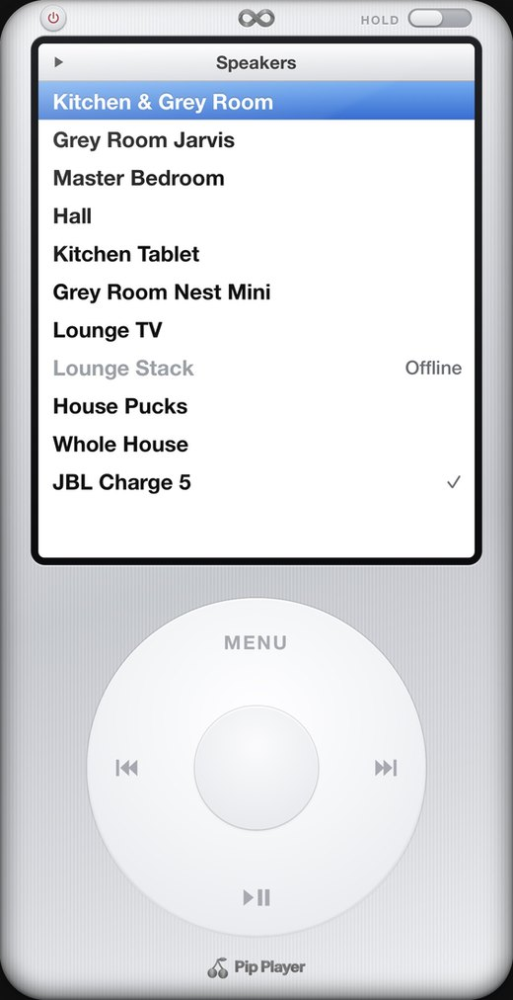

# Pip Player

A retro click-wheel music player card for Home Assistant and Music Assistant.

Spin the wheel to scroll and change the volume, press the buttons to skip and play, and pick your music from menus, just like the classic pocket music players of the 2000s.

> **Before you start: Pip Player needs Music Assistant.** You need the Music Assistant app (the server) and the Music Assistant integration in Home Assistant, with at least one speaker added. Pip Player plays everything through Music Assistant, so it won't work without it. [Set up Music Assistant](https://www.music-assistant.io/get-started/)



[](https://my.home-assistant.io/redirect/hacs_repository/?owner=0xwilko&repository=pip-player-card&category=plugin)

## Features

- A silver (or black) player body with a working click wheel: turn it to scroll menus or change the volume, press MENU, ⏮, ⏭, ▶❚❚ and the centre button.
- Now Playing screen with album art, title, artist, album and a progress bar. Tap the screen to play or pause.
- Playlists, radio stations and speakers, all from Music Assistant.
- A mute symbol shows when a speaker is muted. Mute it from the menu, and turning the volume brings the sound back.
- Search your music and Spotify (or any other Music Assistant provider) by song, artist, album or playlist, plus search inside any playlist. Your phone keyboard pops up, and its microphone key lets you speak the search.
- Picking or skipping a song gets it ready without playing it. Nothing starts until you press play.
- If Spotify (or another service that only plays on one speaker at a time) is already playing elsewhere, Pip Player tells you which speaker has it and lets you play here or move that music here.
- Hold switch: on its own it locks the player, or point it at a helper to make it an admin lock, so only chosen people can take over the music.
- Full-screen phone mode that fits the screen exactly, with a power button to leave.
- Click sounds (and a light tap on iPhone with iOS 18 or later), saved per person in Home Assistant.
- Point-and-click options screen when you edit the card, so no YAML is needed.
- Settings menu with finish, clicker, an optional classic control panel, an add a Bluetooth speaker helper, About and the version history.

## What you need

- Home Assistant 2025.2 or newer.
- **Music Assistant (required):** the [Music Assistant app](https://www.music-assistant.io/get-started/) (the server) and the [Music Assistant integration](https://www.home-assistant.io/integrations/music_assistant/), with at least one speaker added. Set this up first.

If Music Assistant isn't set up, Pip Player shows a message saying so, with a link to the setup guide.

## Install

Set up Music Assistant first (see above). Then:

Home Assistant 2026.11 and newer (Marketplace):

1. Settings → Marketplace.
2. Search for Pip Player and download it. Until it appears in the catalog, use Add from link with `https://github.com/0xwilko/pip-player-card`.
3. Reload your browser.

Home Assistant 2026.10 and older (HACS):

1. Open HACS and search for Pip Player, or use the button above to add it as a custom repository (type Dashboard).
2. Download it and reload your browser.

Manual:

1. Copy `dist/pip-player-card.js` to `/config/www/`.
2. Settings → Dashboards → ⋮ → Resources → Add resource: `/local/pip-player-card.js`, type JavaScript module.

## Quick start

Edit your dashboard, press Add card and search for Pip Player. That's all you need: the card finds your Music Assistant speakers by itself.

Every option can be changed in the card's own options screen, so YAML is optional. In YAML the card is simply:

```yaml
type: custom:pip-player-card
```

## Full-screen phone page (recommended)

Make a new dashboard, add a view of type Panel, and put the card in it:

```yaml
type: custom:pip-player-card
fit_screen: true
max_width: 430
exit_button: true
players:
  - entity: media_player.kitchen
    name: Kitchen
  - entity: media_player.lounge
    name: Lounge
```

To hide the Home Assistant header as well, add [kiosk-mode](https://github.com/NemesisRE/kiosk-mode) and put this at the top of that dashboard's raw configuration:

```yaml
kiosk_mode:
  kiosk: true
```

The power button at the top left takes you back.

## Options

All of these can be set in the card's options screen, except `admin_ids`, which is YAML only.

| Option | Default | What it does |
| --- | --- | --- |
| `players` | all Music Assistant players | List of speakers, as entity IDs or `{entity, name}` pairs. |
| `default_player` | first available | Speaker to start on. |
| `fit_screen` | `false` | Sizes the player to fill the screen with no scrolling. |
| `max_width` | `340` | Widest the player will grow, in pixels. |
| `exit_button` | `false` | Shows the power button that leaves the page. |
| `exit_path` | back | Page to open when the power button is pressed, for example `/lovelace/0`. |
| `lock_entity` | none | An `input_boolean` used by the Hold switch as an admin lock. |
| `admin_ids` | Home Assistant admins | User IDs allowed to move the Hold switch when `lock_entity` is set. |
| `finish` | `silver` | `silver` or `black`. Each person can change it in Settings. |
| `clicker` | `true` | Click sounds. Each person can turn them off in Settings. |
| `controls` | `false` | Shows a classic control panel under the player. |
| `volume_step` | `2` | Volume change per wheel click, in percent. |
| `seek_step` | `5` | Seconds moved per wheel click while scrubbing. |
| `splash` | `true` | Shows the logo for a moment when the player opens. |
| `storage_key` | none | Keeps settings separate when you use more than one Pip Player. |
| `maker` | `true` | Set to `false` to hide the maker badge at the top. |
| `mass_entry_id` | found automatically | Music Assistant config entry ID, only needed if search can't find it. |

## Using the wheel

| Where | Turn the wheel | MENU | ⏮ / ⏭ | ▶❚❚ | Centre |
| --- | --- | --- | --- | --- | --- |
| Menus | Scroll | Back | Back / Select | Play or pause | Select |
| Now Playing | Volume (or scrub) | Menus | Previous / next song | Play or pause | Switch the wheel between volume and scrubbing |

Hold MENU to jump straight to the main menu. On the Now Playing screen you can also tap the screen to play or pause.

A crossed-out speaker at the top of the screen means the speaker is muted. Turn the volume to bring the sound back, or press MENU and choose Mute to turn mute on or off.

## The Hold switch as an admin lock

1. Settings → Devices & services → Helpers → Create helper → Toggle. Call it something like Music admin lock.
2. Add `lock_entity: input_boolean.music_admin_lock` to the card.
3. Optional: add `admin_ids` with the user IDs who may use it (Settings → People → Users). Without it, Home Assistant admins can use it.

When the Hold switch is on, everyone else can still browse and search, but only the admins can play, skip or change the volume.

## Bluetooth speakers

Pip Player plays to anything Music Assistant can see. To use a Bluetooth speaker paired to your Home Assistant machine, install one of these apps (Home Assistant OS):

- [Sendspin Bluetooth Bridge](https://github.com/trudenboy/sendspin-bt-bridge) (recommended). Each paired speaker becomes its own Music Assistant player.
- [Bluetooth Audio Manager](https://github.com/scyto/ha-bluetooth-audio-manager), an alternative.

Use only one of them for a given speaker. Admins can open either app from Pip Player: MENU → Settings → Add Bluetooth speaker.

## Privacy and safety

- The card only talks to your own Home Assistant. It sends nothing anywhere else.
- Settings are saved against each person's Home Assistant login.
- The links on the About page and the maker badge just open the maker's public pages in your browser.

## More pictures

| Black finish | Speakers |
| --- | --- |
|  |  |

## About

Made by Tim Wilkinson ([0xwilko](https://github.com/0xwilko)). Also on the [Home Assistant forum](https://community.home-assistant.io/u/0xwilko) and [Discord](https://discord.com/users/1346380954897354782), and at [twilkinsondata.com](https://twilkinsondata.com).

Pip Player is its own brand. It is not affiliated with, or endorsed by, any other company.

## Licence

[MIT](LICENSE)
